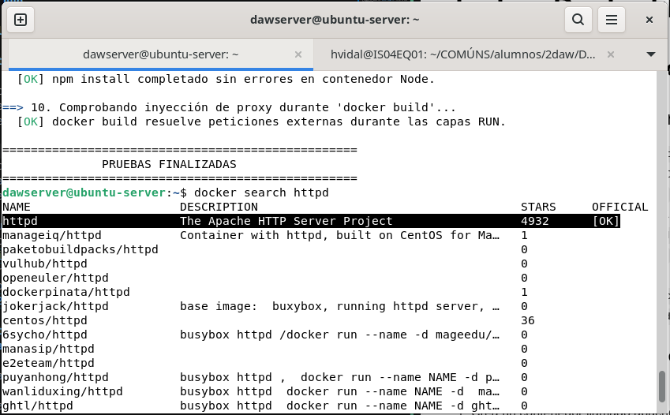
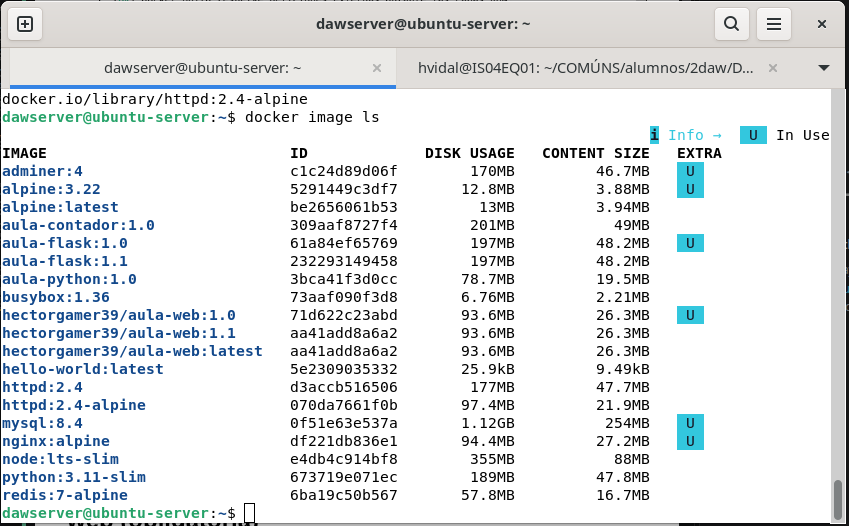
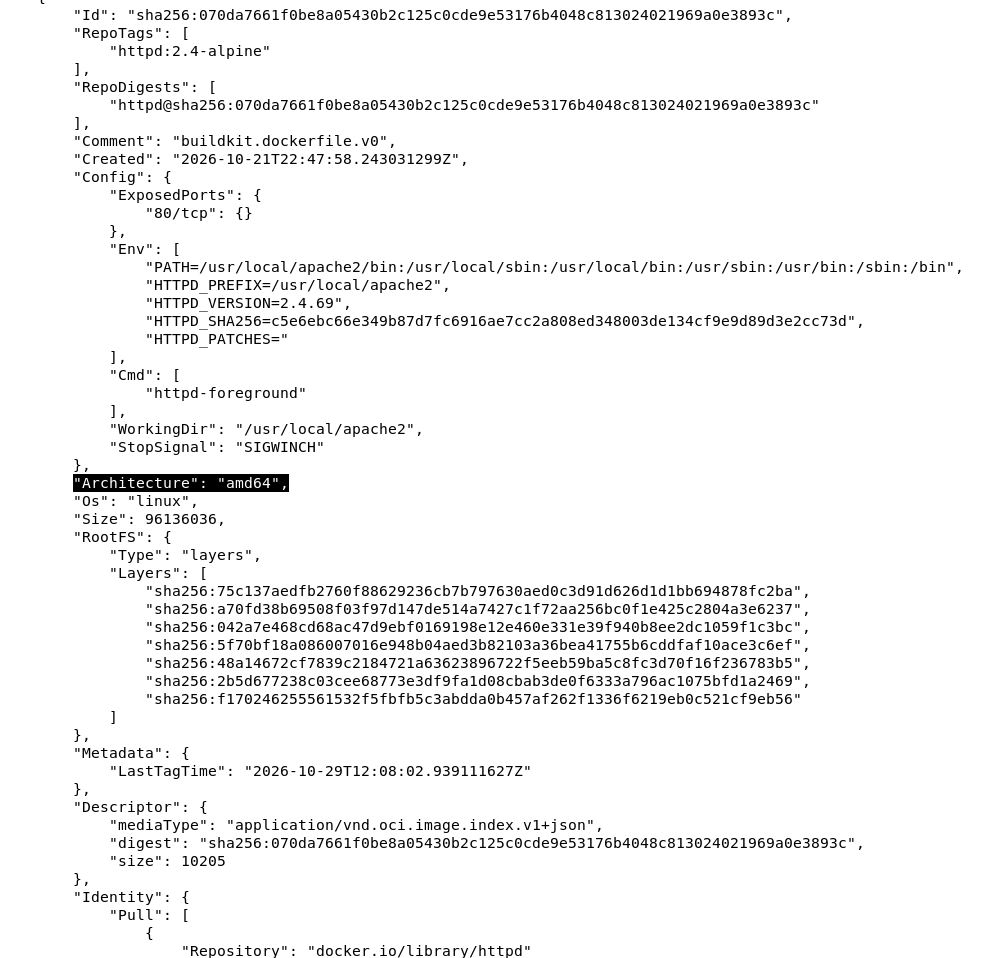
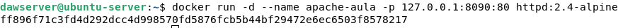
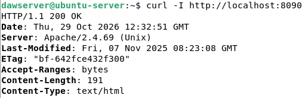

# Ciclo de vida de contenedores docker, Dockerfile y docker hub

## Ciclo de vida de un contenedor

### Actividad 1.1: explorar una imagen

1. Busca la imagen de Apache con `docker search httpd`. ¿Que resultado corresponde a la imagen oficial y como lo has identificado?

    
    lo identifique porque es la que esta marcado con un ok en la columna oficial.

2. Descarga las etiquetas `httpd:2.4` y `httpd:2.4-alpine` y compara su tamaño con `docker image ls`. ¿A qué se debe la diferencia?

    
    el de alpine esta preparado por Alpine Linux, una distribución pequeña que permite reducir el tamaño de la descarga.
3. Con `docker image inspect httpd:2.4-alpine`, localiza la arquitectura, el puerto que declara (`ExposedPorts`), el proceso principal (`Cmd`), la carpeta de trabajo (`WorkingDir`) y la señal de parada (`StopSignal`). Para obtener un dato concreto puedes usar `--format`, por ejemplo `docker image inspect --format '{{.Config.Cmd}}' httpd:2.4-alpine`.
    
    - Arquitectura: amd64
    - ExposedPorts: 80/tcp
    - WorkingDir: /usr/local/apache2
    - StopSignal: SIGWINCH

### Actividad 1.2: ejecutar y comprobar un servidor web (obligatoria)

1. Crea un contenedor llamado apache-aula, en segundo plano, a partir de httpd:2.4-alpine, publicando su puerto 80 en el puerto 8090 del equipo y solo en la propia VM. Escribe tú la orden y explica cada una de sus partes.

    
    - docker run: crear e inicializar contenedor
    - -d: Segundo plano
    - --name apache-aula: asignar nombre
    - -p 127.0.0.1:8090:80: publica un puerto del contenedor hacia el host
    - httpd:2.4-alpine: imagen desde la que se crea el contenedoor
2. Comprueba con curl que responde y qué contenido muestra. ¿De qué archivo del contenedor sale ese contenido? (Usa la documentación de la imagen y docker exec para encontrarlo).

    

```bash
    docker exec apache-aula cat /usr/local/apache2/htdocs/index.html
```

### Actividad 1.3: seguir el ciclo de vida

Usa el contenedor apache-aula de la actividad anterior. Ejecuta las órdenes una a una y, después de cada operación, consulta `docker ps -a` y comprueba con `curl -I http://localhost:8090` si el servidor responde:

```bash
docker stop apache-aula
docker start apache-aula
docker restart apache-aula
docker rm apache-aula
docker rm -f apache-aula
docker image ls
```

Completa esta tabla:

| Operación | Estado de apache-aula (STATUS) | ¿Responde curl? | ¿Sigue disponible httpd:2.4-alpine? |
| --- | --- | --- | --- |
| Antes de empezar | | | |
| docker stop apache-aula | | | |
| docker start apache-aula | | | |
| docker restart apache-aula | | | |
| docker rm apache-aula | | | |
| docker rm -f apache-aula | | | |

1. ¿Por qué falla `docker rm apache-aula` y no `docker rm -f apache-aula`?
2. ¿Por qué eliminar el contenedor no elimina la imagen?

### Actividad 1.4: cambios dentro de un contenedor

1. Crea un contenedor `apache-cambios` de `httpd:2.4-alpine` publicado en `127.0.0.1:8091`. Con `docker exec`, añade una página `equipo.html` a la carpeta de documentos de Apache con los nombres de tu equipo de trabajo, y compruébala con `curl`.
2. Muestra con `docker diff apache-cambios` qué ha cambiado respecto a la imagen.
3. Detén y arranca de nuevo el contenedor. ¿Se conserva `equipo.html`? ¿Por qué?
4. Elimina el contenedor y crea otro con el mismo nombre y la misma imagen. ¿Se conserva? ¿Por qué?
5. Explica por qué editar un contenedor en marcha no es una forma adecuada de desplegar cambios en una aplicación y cuál sería la forma correcta.

### Actividad 1.5: diagnosticar contenedores que se detienen

Cada uno de estos contenedores se detiene nada más arrancar, por un motivo distinto:

```bash
docker run -d --name diag-1 ubuntu:24.04
docker run -d --name diag-2 postgres:17-alpine
docker run -d --name diag-3 nginx:alpine nginx -g "daemon on;"
```

1. Comprueba con docker ps y docker ps -a el estado de cada uno y obtén su código de salida con
docker inspect -f '{{.State.ExitCode}}' NOMBRE.
2. Consulta sus logs. Para cada contenedor, explica la causa por la que se ha detenido. En el caso de
diag-3, compara la orden con el CMD de la imagen de Nginx (docker image inspect): ¿qué hace la
opción daemon on y por qué detiene el contenedor?

## Construir imágenes con Dockerfile

En esta sección se trabaja con una aplicación web mínima en Node.js con el framework Express, en lugar de la
aplicación Python de los apuntes. El Dockerfile lo escribes tú.
saludo/app.js:

```bash
const express = require('express');
const app = express();
const puerto = process.env.PUERTO || 3000;
const mensaje = process.env.MENSAJE || 'Mensaje por defecto';
app.get('/', (req, res) => res.send(`<h1>${mensaje}</h1>`));
app.get('/salud', (req, res) => res.json({ estado: 'ok' }));
app.listen(puerto, '0.0.0.0', () => console.log(`Escuchando en el puerto
${puerto}`));
```

saludo/package.json:

```bash
{
 "name": "saludo",
 "version": "1.0.0",
 "main": "app.js",
 "dependencies": {
 "express": "^5.1.0"
 }
```

En Node.js, las dependencias se declaran en package.json (como requirements.txt en Python) y se instalan con npm install. La opción --omit=dev omite las dependencias que solo se necesitan para desarrollar.

### Actividad 2.1: construir imágenes paso a paso

Parte A: una web estática con Apache.

1. Crea una carpeta web-apache con una página index.html y una hoja de estilos, y escribe un
Dockerfile que construya una imagen web-apache:1.0 a partir de httpd:2.4-alpine con esos
archivos. Consulta en la documentación de la imagen en qué carpeta sirve Apache sus documentos.
2. Ejecútala y compruébala con curl. Explica por qué este Dockerfile no necesita CMD ni EXPOSE.

Parte B: la aplicación Node.js.

1. Escribe un Dockerfile para saludo que:
Parta de la imagen node:24-alpine.
Trabaje en la carpeta /app.
Instale las dependencias antes de copiar el código, para aprovechar la caché.
Defina MENSAJE con un valor propio mediante ENV.
Ejecute la aplicación con el usuario sin privilegios node, que ya existe en la imagen.
Documente el puerto y arranque la aplicación con CMD en forma exec.
2. Construye la imagen saludo:1.0, ejecútala y comprueba / y /salud con curl:

    ```bash
    curl http://localhost:3000/
    curl http://localhost:3000/salud
    ```

3. Comprueba con docker exec el usuario y la carpeta de trabajo del proceso.

4. Ejecuta un segundo contenedor cambiando el mensaje y el puerto con -e (MENSAJE y PUERTO), sin
reconstruir la imagen. ¿Qué tienes que cambiar también en la opción -p? ¿Por qué?

5. Indica, para cada instrucción de tu Dockerfile, si actúa durante la construcción, durante la ejecución o
en ambas.

### Actividad 2.2: publicar y versionar una imagen

1. Publica la imagen saludo con la etiqueta 1.0 en tu cuenta de Docker Hub. En la salida de docker
image push, señala qué capas se subieron y cuáles se reutilizaron (montadas desde otro repositorio), y
explica por qué.
2. Elimina todas las copias locales de la imagen, ejecútala a partir de Docker Hub y comprueba con curl
que responde.
3. Cambia el mensaje por defecto, publica la versión 1.1 y añádele también la etiqueta latest.
4. Comprueba en la pestaña Tags de Docker Hub la arquitectura de las imágenes publicadas.